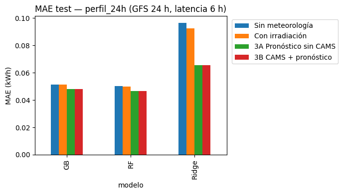
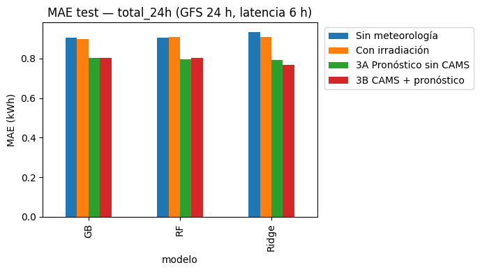
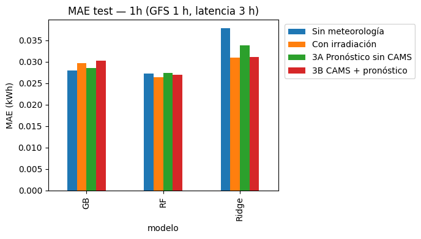
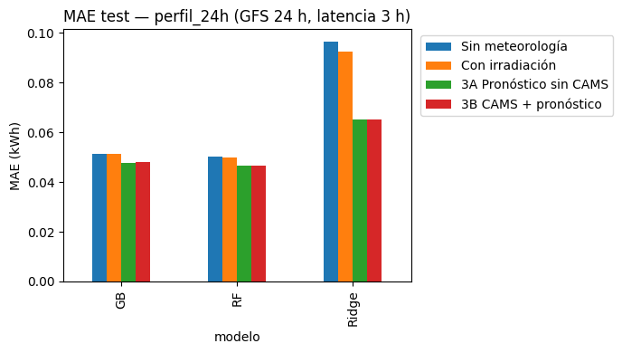
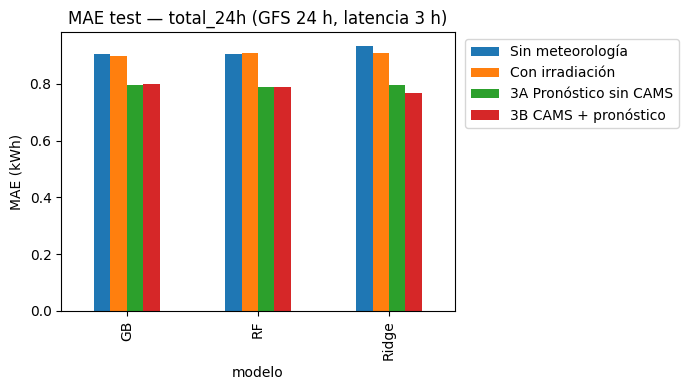

# Resultados nivel 3 (GFS), objetivos de 1 h, perfil 24 h y total 24 h

Estado: completo para los tres objetivos y las cuatro configuraciones. Los pronósticos GFS cubren 2020 completo (ciclos de 6 h, f003 a f036) más los ciclos del 31/12/2019.

Cómo se obtuvo: notebook `notebooks/FVAA_fase1.ipynb` con datos reales PR20 2020 (hora UTC). Se ejecutó una copia que carga la producción por trozos por limitación de RAM (`scripts/memoria_limitada/`), **no la ejecución oficial del notebook sin modificar**; mismo DataFrame, modelos, particiones y métricas. GFS: DSWRF de una celda (32,75 N, 343,0 E) descargado con el subset por lotes de GDEX (ds084.1, solicitudes 996991 y 996992) y leído con `scripts/leer_gdex_grib2.py`.

Particiones: entrenamiento ene-ago, validación sep-oct, test nov-dic 2020 (el test ya está observado: el modelo se elige por MAE de validación, nunca por test). Latencia principal 6 h, sensibilidad 3 h (`merge_asof` hacia atrás); la muestra común a las cuatro configuraciones y a las dos latencias se aplica antes de ajustar. `MAE_cv_temporal` (TimeSeriesSplit, 3 cortes, solo entrenamiento+validación) es información adicional y no se usó para elegir.

Configuraciones: N1 = producción + calendario; N2 = N1 + CAMS; 3A = N1 + GFS; 3B = N1 + CAMS + GFS. Todos los niveles se comparan en la misma muestra GFS. MAE, MSE y RMSE se dan por separado; las unidades están en cada sección.

## Objetivo 1 h

### Latencia 6 h

Muestras (iguales para las cuatro configuraciones): n_train=5780, n_val=1453, n_test=1447. Unidad: kWh por hora.

| nivel   | modelo   |   MAE_val |   MAE_cv_temporal |     MAE |     MSE |    RMSE |
|:--------|:---------|----------:|------------------:|--------:|--------:|--------:|
| N1      | Ridge    |   0.03766 |           0.03318 | 0.03786 | 0.00458 | 0.06768 |
| N1      | RF       |   0.02777 |           0.02523 | 0.02721 | 0.00324 | 0.05693 |
| N1      | GB       |   0.02748 |           0.02531 | 0.02797 | 0.00337 | 0.05804 |
| N2      | Ridge    |   0.02890 |           0.02713 | 0.03098 | 0.00371 | 0.06094 |
| N2      | RF       |   0.02482 |           0.02611 | 0.02638 | 0.00307 | 0.05539 |
| N2      | GB       |   0.02726 |           0.02716 | 0.02972 | 0.00351 | 0.05924 |
| 3A      | Ridge    |   0.03413 |           0.02781 | 0.03405 | 0.00440 | 0.06637 |
| 3A      | RF       |   0.02704 |           0.02577 | 0.02729 | 0.00325 | 0.05698 |
| 3A      | GB       |   0.02835 |           0.02712 | 0.02894 | 0.00346 | 0.05879 |
| 3B      | Ridge    |   0.02905 |           0.02672 | 0.03116 | 0.00375 | 0.06122 |
| 3B      | RF       |   0.02481 |           0.02744 | 0.02684 | 0.00317 | 0.05632 |
| 3B      | GB       |   0.02735 |           0.02899 | 0.02962 | 0.00347 | 0.05893 |

Modelo elegido por validación (test del elegido): N1 GB (0.0280); N2 RF (0.0264); 3A RF (0.0273); 3B RF (0.0268).

Mínimo de test observado (solo informativo, no se usa para elegir): N2 RF, MAE 0.0264.

Mejora de MAE de test en % (positivo = mejora; mismo modelo; calculada con el MAE sin redondear y redondeada al final):

| modelo   |   N2 vs N1 |   3A vs N1 |   3B vs N2 |   3B vs 3A |
|:---------|-----------:|-----------:|-----------:|-----------:|
| GB       |      -6.26 |      -3.45 |       0.34 |      -2.36 |
| RF       |       3.05 |      -0.29 |      -1.73 |       1.66 |
| Ridge    |      18.17 |      10.07 |      -0.59 |       8.48 |

### Latencia 3 h

Muestras (iguales para las cuatro configuraciones): n_train=5780, n_val=1453, n_test=1447. Unidad: kWh por hora.

| nivel   | modelo   |   MAE_val |   MAE_cv_temporal |     MAE |     MSE |    RMSE |
|:--------|:---------|----------:|------------------:|--------:|--------:|--------:|
| N1      | Ridge    |   0.03766 |           0.03318 | 0.03786 | 0.00458 | 0.06768 |
| N1      | RF       |   0.02777 |           0.02523 | 0.02721 | 0.00324 | 0.05693 |
| N1      | GB       |   0.02748 |           0.02531 | 0.02797 | 0.00337 | 0.05804 |
| N2      | Ridge    |   0.02890 |           0.02713 | 0.03098 | 0.00371 | 0.06094 |
| N2      | RF       |   0.02482 |           0.02611 | 0.02638 | 0.00307 | 0.05539 |
| N2      | GB       |   0.02726 |           0.02716 | 0.02972 | 0.00351 | 0.05924 |
| 3A      | Ridge    |   0.03414 |           0.02785 | 0.03387 | 0.00435 | 0.06594 |
| 3A      | RF       |   0.02698 |           0.02592 | 0.02742 | 0.00326 | 0.05708 |
| 3A      | GB       |   0.02825 |           0.02685 | 0.02858 | 0.00343 | 0.05861 |
| 3B      | Ridge    |   0.02904 |           0.02668 | 0.03107 | 0.00373 | 0.06105 |
| 3B      | RF       |   0.02486 |           0.02698 | 0.02690 | 0.00316 | 0.05626 |
| 3B      | GB       |   0.02737 |           0.02861 | 0.03026 | 0.00363 | 0.06027 |

Modelo elegido por validación (test del elegido): N1 GB (0.0280); N2 RF (0.0264); 3A RF (0.0274); 3B RF (0.0269).

Mínimo de test observado (solo informativo, no se usa para elegir): N2 RF, MAE 0.0264.

Mejora de MAE de test en % (positivo = mejora; mismo modelo; calculada con el MAE sin redondear y redondeada al final):

| modelo   |   N2 vs N1 |   3A vs N1 |   3B vs N2 |   3B vs 3A |
|:---------|-----------:|-----------:|-----------:|-----------:|
| GB       |      -6.26 |      -2.17 |      -1.82 |      -5.9  |
| RF       |       3.05 |      -0.78 |      -1.97 |       1.91 |
| Ridge    |      18.17 |      10.54 |      -0.3  |       8.26 |

## Objetivo perfil 24 h (24 valores horarios)

### Latencia 6 h

Muestras (iguales para las cuatro configuraciones): n_train=5255, n_val=1321, n_test=1273. Unidad: kWh por hora (media de las 24 h).

| nivel   | modelo   |   MAE_val |   MAE_cv_temporal |    MAE |    MSE |   RMSE |
|:--------|:---------|----------:|------------------:|-------:|-------:|-------:|
| N1      | Ridge    |    0.0913 |            0.0886 | 0.0966 | 0.0181 | 0.1345 |
| N1      | RF       |    0.0465 |            0.0429 | 0.0501 | 0.0087 | 0.0935 |
| N1      | GB       |    0.0475 |            0.0449 | 0.0513 | 0.0087 | 0.0931 |
| N2      | Ridge    |    0.0851 |            0.0758 | 0.0925 | 0.0169 | 0.1299 |
| N2      | RF       |    0.0458 |            0.0429 | 0.0497 | 0.0088 | 0.0939 |
| N2      | GB       |    0.0467 |            0.0455 | 0.0512 | 0.0087 | 0.0932 |
| 3A      | Ridge    |    0.0504 |            0.0469 | 0.0655 | 0.0100 | 0.0999 |
| 3A      | RF       |    0.0435 |            0.0402 | 0.0466 | 0.0075 | 0.0868 |
| 3A      | GB       |    0.0461 |            0.0469 | 0.0479 | 0.0081 | 0.0898 |
| 3B      | Ridge    |    0.0494 |            0.0466 | 0.0655 | 0.0096 | 0.0980 |
| 3B      | RF       |    0.0431 |            0.0401 | 0.0465 | 0.0075 | 0.0868 |
| 3B      | GB       |    0.0460 |            0.0472 | 0.0481 | 0.0080 | 0.0897 |

Modelo elegido por validación (test del elegido): N1 RF (0.0501); N2 RF (0.0497); 3A RF (0.0466); 3B RF (0.0465).

Mínimo de test observado (solo informativo, no se usa para elegir): 3B RF, MAE 0.0465.

Mejora de MAE de test en % (positivo = mejora; mismo modelo; calculada con el MAE sin redondear y redondeada al final):

| modelo   |   N2 vs N1 |   3A vs N1 |   3B vs N2 |   3B vs 3A |
|:---------|-----------:|-----------:|-----------:|-----------:|
| GB       |       0.01 |       6.44 |       6.18 |      -0.26 |
| RF       |       0.87 |       6.99 |       6.38 |       0.23 |
| Ridge    |       4.22 |      32.16 |      29.15 |      -0.03 |

### Latencia 3 h

Muestras (iguales para las cuatro configuraciones): n_train=5255, n_val=1321, n_test=1273. Unidad: kWh por hora (media de las 24 h).

| nivel   | modelo   |   MAE_val |   MAE_cv_temporal |    MAE |    MSE |   RMSE |
|:--------|:---------|----------:|------------------:|-------:|-------:|-------:|
| N1      | Ridge    |    0.0913 |            0.0886 | 0.0966 | 0.0181 | 0.1345 |
| N1      | RF       |    0.0465 |            0.0429 | 0.0501 | 0.0087 | 0.0935 |
| N1      | GB       |    0.0475 |            0.0449 | 0.0513 | 0.0087 | 0.0931 |
| N2      | Ridge    |    0.0851 |            0.0758 | 0.0925 | 0.0169 | 0.1299 |
| N2      | RF       |    0.0458 |            0.0429 | 0.0497 | 0.0088 | 0.0939 |
| N2      | GB       |    0.0467 |            0.0455 | 0.0512 | 0.0087 | 0.0932 |
| 3A      | Ridge    |    0.0501 |            0.0468 | 0.0651 | 0.0099 | 0.0996 |
| 3A      | RF       |    0.0433 |            0.0398 | 0.0467 | 0.0075 | 0.0867 |
| 3A      | GB       |    0.0455 |            0.0467 | 0.0478 | 0.0079 | 0.0890 |
| 3B      | Ridge    |    0.0491 |            0.0465 | 0.0652 | 0.0096 | 0.0978 |
| 3B      | RF       |    0.0431 |            0.0397 | 0.0467 | 0.0075 | 0.0868 |
| 3B      | GB       |    0.0454 |            0.0467 | 0.0479 | 0.0080 | 0.0892 |

Modelo elegido por validación (test del elegido): N1 RF (0.0501); N2 RF (0.0497); 3A RF (0.0467); 3B RF (0.0467).

Mínimo de test observado (solo informativo, no se usa para elegir): 3A RF, MAE 0.0467.

Mejora de MAE de test en % (positivo = mejora; mismo modelo; calculada con el MAE sin redondear y redondeada al final):

| modelo   |   N2 vs N1 |   3A vs N1 |   3B vs N2 |   3B vs 3A |
|:---------|-----------:|-----------:|-----------:|-----------:|
| GB       |       0.01 |       6.77 |       6.57 |      -0.2  |
| RF       |       0.87 |       6.84 |       6.04 |       0.01 |
| Ridge    |       4.22 |      32.61 |      29.51 |      -0.18 |

## Objetivo total 24 h (energía del día)

### Latencia 6 h

Muestras (iguales para las cuatro configuraciones): n_train=5255, n_val=1321, n_test=1273. Unidad: kWh por día.

| nivel   | modelo   |   MAE_val |   MAE_cv_temporal |    MAE |    MSE |   RMSE |
|:--------|:---------|----------:|------------------:|-------:|-------:|-------:|
| N1      | Ridge    |    0.7003 |            0.7204 | 0.9340 | 1.3250 | 1.1511 |
| N1      | RF       |    0.7091 |            0.7731 | 0.9056 | 1.2681 | 1.1261 |
| N1      | GB       |    0.7014 |            0.7629 | 0.9052 | 1.2500 | 1.1180 |
| N2      | Ridge    |    0.7019 |            0.6944 | 0.9068 | 1.2569 | 1.1211 |
| N2      | RF       |    0.7201 |            0.7479 | 0.9073 | 1.2744 | 1.1289 |
| N2      | GB       |    0.7022 |            0.7473 | 0.8970 | 1.2334 | 1.1106 |
| 3A      | Ridge    |    1.1496 |            0.9210 | 0.7932 | 0.8999 | 0.9486 |
| 3A      | RF       |    0.7159 |            0.6816 | 0.7956 | 1.0465 | 1.0230 |
| 3A      | GB       |    0.7170 |            0.7179 | 0.8009 | 0.9833 | 0.9916 |
| 3B      | Ridge    |    1.0928 |            0.9180 | 0.7675 | 0.8650 | 0.9300 |
| 3B      | RF       |    0.7295 |            0.6921 | 0.8007 | 1.0567 | 1.0279 |
| 3B      | GB       |    0.7200 |            0.7206 | 0.8027 | 0.9932 | 0.9966 |

Modelo elegido por validación (test del elegido): N1 Ridge (0.9340); N2 Ridge (0.9068); 3A RF (0.7956); 3B GB (0.8027).

Mínimo de test observado (solo informativo, no se usa para elegir): 3B Ridge, MAE 0.7675.

Mejora de MAE de test en % (positivo = mejora; mismo modelo; calculada con el MAE sin redondear y redondeada al final):

| modelo   |   N2 vs N1 |   3A vs N1 |   3B vs N2 |   3B vs 3A |
|:---------|-----------:|-----------:|-----------:|-----------:|
| GB       |       0.91 |      11.52 |      10.51 |      -0.23 |
| RF       |      -0.18 |      12.15 |      11.75 |      -0.64 |
| Ridge    |       2.92 |      15.07 |      15.36 |       3.24 |

### Latencia 3 h

Muestras (iguales para las cuatro configuraciones): n_train=5255, n_val=1321, n_test=1273. Unidad: kWh por día.

| nivel   | modelo   |   MAE_val |   MAE_cv_temporal |    MAE |    MSE |   RMSE |
|:--------|:---------|----------:|------------------:|-------:|-------:|-------:|
| N1      | Ridge    |    0.7003 |            0.7204 | 0.9340 | 1.3250 | 1.1511 |
| N1      | RF       |    0.7091 |            0.7731 | 0.9056 | 1.2681 | 1.1261 |
| N1      | GB       |    0.7014 |            0.7629 | 0.9052 | 1.2500 | 1.1180 |
| N2      | Ridge    |    0.7019 |            0.6944 | 0.9068 | 1.2569 | 1.1211 |
| N2      | RF       |    0.7201 |            0.7479 | 0.9073 | 1.2744 | 1.1289 |
| N2      | GB       |    0.7022 |            0.7473 | 0.8970 | 1.2334 | 1.1106 |
| 3A      | Ridge    |    1.1549 |            0.9202 | 0.7941 | 0.8982 | 0.9477 |
| 3A      | RF       |    0.7154 |            0.6860 | 0.7879 | 1.0204 | 1.0102 |
| 3A      | GB       |    0.7232 |            0.7468 | 0.7971 | 0.9826 | 0.9913 |
| 3B      | Ridge    |    1.1006 |            0.9197 | 0.7660 | 0.8602 | 0.9275 |
| 3B      | RF       |    0.7208 |            0.6939 | 0.7872 | 1.0198 | 1.0098 |
| 3B      | GB       |    0.7166 |            0.7266 | 0.7983 | 0.9831 | 0.9915 |

Modelo elegido por validación (test del elegido): N1 Ridge (0.9340); N2 Ridge (0.9068); 3A RF (0.7879); 3B GB (0.7983).

Mínimo de test observado (solo informativo, no se usa para elegir): 3B Ridge, MAE 0.7660.

Mejora de MAE de test en % (positivo = mejora; mismo modelo; calculada con el MAE sin redondear y redondeada al final):

| modelo   |   N2 vs N1 |   3A vs N1 |   3B vs N2 |   3B vs 3A |
|:---------|-----------:|-----------:|-----------:|-----------:|
| GB       |       0.91 |      11.95 |      11    |      -0.16 |
| RF       |      -0.18 |      13    |      13.23 |       0.09 |
| Ridge    |       2.92 |      14.98 |      15.53 |       3.54 |

Referencias sobre las mismas muestras de test (día anterior): 1 h, MAE 0.05567 (última hora: 0.04448); perfil 24 h, MAE 0.05535; total 24 h, MAE 0.91441.

Qué hay en la ejecución: 54 filas por latencia = 18 del estudio con meteorología histórica (3 objetivos x 2 niveles x 3 modelos) + 36 del estudio con pronósticos GFS (3 objetivos x 4 configuraciones x 3 modelos). Las tablas de arriba son las 36 del estudio con GFS; la clave estudio/objetivo/nivel/modelo no tiene duplicados y las muestras de las 4 configuraciones son idénticas en las dos latencias.

Lectura (modelos elegidos por validación, latencia 6 h; con 3 h el resultado es el mismo en sentido):
- 1 h: el 3A elegido (RF, 0.0273) tiene menos MAE que el N1 elegido (GB, 0.0280), un 2.4 %, pero son modelos de familias distintas; con el mismo modelo, 3A frente a N1 es -3.45 % en GB, -0.29 % en RF y +10.07 % en Ridge (latencia 6 h). Además 3B (RF, 0.0268) queda peor que N2 (RF, 0.0264). El mínimo de test es N2 con RF, sin GFS. GFS no mejora de forma clara el objetivo de 1 h.
- Perfil 24 h: con GFS el MAE baja (3A RF 0.0466 frente a N1 RF 0.0501, 7.0 %; 3B RF 0.0465 frente a N2 RF 0.0497, 6.4 %). 3B frente a 3A no cambia (0.2 %). Los tres modelos mejoran con GFS; en Ridge la mejora es mucho mayor (0.0966 a 0.0655), pero Ridge no es el modelo elegido.
- Total 24 h: 3A (RF, 0.7956) mejora a N1 (Ridge, 0.9340) un 14.8 %, y 3B (GB, 0.8027) a N2 (Ridge, 0.9068) un 11.5 %. 3B no mejora a 3A (-0.9 %). El mínimo de test (3B Ridge, 0.7675) no es el elegido por validación y es solo informativo. N1 y N2 no superan la referencia del día anterior (0.9144) de forma clara; 3A y 3B sí.
- CAMS (N2 y 3B) aporta poco una vez hay GFS en 24 h; sin GFS aporta algo en 1 h con Ridge.
- Las diferencias entre latencia 3 h y 6 h son pequeñas (ver tablas).

Es un solo experimento (PR20, 2020, un solo año, una celda GFS aproximada a Madeira, test ya observado): no se generaliza. MAE, MSE y RMSE no se mezclan; no se afirma causalidad.

Los valores negativos de DSWRF vienen del intervalo de 3 h reconstruido (2 x promedio de 6 h menos promedio de 3 h): se documentan y se truncan a cero en el notebook (564 valores truncados en la serie de GFS).

## Figuras

## Cuantiles P10 / P50 / P90 (objetivos escalares: 1 h y total 24 h)

Se ajustan tres GradientBoostingRegressor con pérdida cuantil (alpha 0.1, 0.5, 0.9; 100 árboles, profundidad 3), con entrenamiento+validación y evaluados en test, y se ordenan por fila (P10 <= P50 <= P90) para evitar cruces. Se calculan en las cuatro configuraciones y en el estudio con meteorología histórica y el estudio con GFS. No se calculan para el perfil de 24 h (así está en el notebook). La cobertura nominal del intervalo P10-P90 es 80 %. No se eligió nada con estos cuantiles y no hay validación cruzada de ellos (un único ajuste).

Los cuantiles solo cambian con la latencia en 3A y 3B (N1 y N2 no usan GFS y dan el mismo resultado en las dos latencias). Los valores salen de la salida del notebook (`display(pd.DataFrame(incertidumbre))`).

### Latencia 6 h

| estudio     | objetivo   | nivel   |   horas_test |   MAE mediana P50 (kWh) |   cobertura P10-P90 (%) |   anchura P90-P10 (kWh) |
|:------------|:-----------|:--------|-------------:|------------------------:|------------------------:|------------------------:|
| historica   | 1h         | N1      |         1447 |                  0.0296 |                 92.8818 |                  0.1480 |
| historica   | 1h         | N2      |         1447 |                  0.0316 |                 86.5238 |                  0.1389 |
| pronosticos | 1h         | N1      |         1447 |                  0.0296 |                 92.8818 |                  0.1480 |
| pronosticos | 1h         | N2      |         1447 |                  0.0316 |                 86.5238 |                  0.1389 |
| pronosticos | 1h         | 3A      |         1447 |                  0.0286 |                 92.1907 |                  0.1443 |
| pronosticos | 1h         | 3B      |         1447 |                  0.0311 |                 89.6337 |                  0.1395 |
| historica   | total_24h  | N1      |         1273 |                  0.9509 |                 69.0495 |                  2.1259 |
| historica   | total_24h  | N2      |         1273 |                  0.9559 |                 70.8562 |                  2.1707 |
| pronosticos | total_24h  | N1      |         1273 |                  0.9509 |                 69.0495 |                  2.1259 |
| pronosticos | total_24h  | N2      |         1273 |                  0.9559 |                 70.8562 |                  2.1707 |
| pronosticos | total_24h  | 3A      |         1273 |                  0.8251 |                 78.8688 |                  2.3412 |
| pronosticos | total_24h  | 3B      |         1273 |                  0.8544 |                 79.9686 |                  2.3832 |

### Latencia 3 h

| estudio     | objetivo   | nivel   |   horas_test |   MAE mediana P50 (kWh) |   cobertura P10-P90 (%) |   anchura P90-P10 (kWh) |
|:------------|:-----------|:--------|-------------:|------------------------:|------------------------:|------------------------:|
| historica   | 1h         | N1      |         1447 |                  0.0296 |                 92.8818 |                  0.1480 |
| historica   | 1h         | N2      |         1447 |                  0.0316 |                 86.5238 |                  0.1389 |
| pronosticos | 1h         | N1      |         1447 |                  0.0296 |                 92.8818 |                  0.1480 |
| pronosticos | 1h         | N2      |         1447 |                  0.0316 |                 86.5238 |                  0.1389 |
| pronosticos | 1h         | 3A      |         1447 |                  0.0290 |                 92.7436 |                  0.1442 |
| pronosticos | 1h         | 3B      |         1447 |                  0.0303 |                 89.4264 |                  0.1381 |
| historica   | total_24h  | N1      |         1273 |                  0.9509 |                 69.0495 |                  2.1259 |
| historica   | total_24h  | N2      |         1273 |                  0.9559 |                 70.8562 |                  2.1707 |
| pronosticos | total_24h  | N1      |         1273 |                  0.9509 |                 69.0495 |                  2.1259 |
| pronosticos | total_24h  | N2      |         1273 |                  0.9559 |                 70.8562 |                  2.1707 |
| pronosticos | total_24h  | 3A      |         1273 |                  0.8312 |                 75.8837 |                  2.2980 |
| pronosticos | total_24h  | 3B      |         1273 |                  0.8429 |                 78.9474 |                  2.3363 |

Lectura: en 1 h la cobertura queda entre 86.5 % y 92.9 % (por encima o cerca del 80 % nominal) y GFS no cambia la mediana de forma clara. En total 24 h la cobertura queda por debajo del 80 % nominal en las cuatro configuraciones (69.0 % y 70.9 % en N1 y N2 con latencia 6 h) y mejora con GFS (3A y 3B, ver tabla), con intervalos algo más anchos y menor MAE de la mediana. Es un solo ajuste en un test ya observado: no se generaliza.

## Validación cruzada temporal (MAE_cv_temporal)

Código: `TimeSeriesSplit(3, gap=h)` sobre las filas válidas de entrenamiento+validación (enero a octubre de 2020, nunca test), con h = 1 para el objetivo de 1 h y h = 24 para perfil y total de 24 h. Ventana creciente: cada corte entrena con todo lo anterior (menos las h filas de separación `gap`) y valida en el bloque siguiente. El valor de la tabla es la media del MAE de los tres bloques. Los cortes se han calculado con la misma carga y filtrado del notebook, sin entrenar modelos, y son iguales en el estudio histórico y en el de GFS (horas UTC):

| objetivo | muestra (filas) | corte | entrenamiento (filas) | validación (filas) |
|:--|--:|--:|:--|:--|
| 1 h | 7233 (2020-01-02 00:00 a 2020-10-31 23:00) | 1 | 1808, hasta 2020-03-17 19:00 | 1808, 2020-03-17 21:00 a 2020-06-01 22:00 |
| 1 h | | 2 | 3616, hasta 2020-06-01 21:00 | 1808, 2020-06-01 23:00 a 2020-08-16 21:00 |
| 1 h | | 3 | 5424, hasta 2020-08-16 20:00 | 1808, 2020-08-16 22:00 a 2020-10-31 23:00 |
| perfil y total 24 h | 6576 (2020-01-03 02:00 a 2020-10-31 00:00) | 1 | 1620, hasta 2020-03-14 13:00 | 1644, 2020-03-15 14:00 a 2020-05-31 01:00 |
| perfil y total 24 h | | 2 | 3264, hasta 2020-05-30 01:00 | 1644, 2020-05-31 02:00 a 2020-08-14 13:00 |
| perfil y total 24 h | | 3 | 4908, hasta 2020-08-13 13:00 | 1644, 2020-08-14 14:00 a 2020-10-31 00:00 |

El entrenamiento de cada corte ya descuenta las filas de `gap` (1 para 1 h, 24 para 24 h). Es una estimación gruesa (3 cortes) y no se usó para elegir modelos; no hay CV de los cuantiles.

## Nota sobre la máscara común entre latencias

La máscara que hace comparables las latencias se aplica ahora por columna (`pron.where(alinear_gfs(..., 6).notna())`), de modo que cada objetivo exige solo las columnas de pronóstico que usa (`h0` para 1 h; `h0` a `h23` para 24 h). Se reejecutaron ambas latencias con el cargador por trozos (copias no oficiales, no el notebook oficial): las 108 filas de resultados (54 por latencia) coinciden con las publicadas en tamaños de muestra, modelos seleccionados y MAE.
