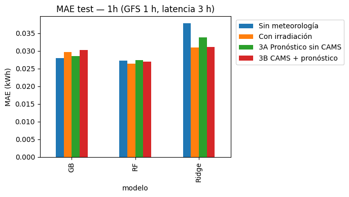

# Resultados nivel 3, objetivo 1 h (GFS 1 h)
Estado: parcial. Solo el objetivo de 1 h. Los objetivos de 24 h con GFS quedan **No evaluado**: la descarga de GFS a 36 h no está completa (con el CSV de 24 h hay 0 muestras de 24 h con latencia 3 h o 6 h).
Cómo se obtuvo: notebook `notebooks/FVAA_fase1.ipynb` ejecutado con datos reales PR20 2020 (hora UTC), con una copia que carga los datos por trozos por limitación de RAM (no es la ejecución oficial del notebook sin modificar). GFS del CSV de 24 h (una celda, 25 puntos).
Muestras: entrenamiento ene-ago, validación sep-oct, test nov-dic, **iguales para las cuatro configuraciones y para las dos latencias** (la muestra común se aplica antes de ajustar): n_train=5780, n_val=1453, n_test=1447.
Latencia principal 6 h; sensibilidad 3 h (`merge_asof` hacia atrás). El test de 2020 ya está observado: el modelo se elige por MAE de validación, nunca por test. `MAE_cv_temporal` es validación cruzada temporal (TimeSeriesSplit, 3 cortes, solo entrenamiento+validación, sin test); es información adicional, no se usó para elegir.
Configuraciones: N1 = producción + calendario; N2 = N1 + CAMS; 3A = N1 + GFS; 3B = N1 + CAMS + GFS.

## Latencia 6 h

MAE en kWh. MAE_val = validación; MAE, MSE, RMSE = test.

| nivel   | modelo   |   MAE_val |   MAE_cv_temporal |     MAE |     MSE |    RMSE |
|:--------|:---------|----------:|------------------:|--------:|--------:|--------:|
| N1      | Ridge    |   0.03766 |           0.03318 | 0.03786 | 0.00458 | 0.06768 |
| N1      | RF       |   0.02777 |           0.02523 | 0.02721 | 0.00324 | 0.05693 |
| N1      | GB       |   0.02748 |           0.02531 | 0.02797 | 0.00337 | 0.05804 |
| N2      | Ridge    |   0.02890 |           0.02713 | 0.03098 | 0.00371 | 0.06094 |
| N2      | RF       |   0.02482 |           0.02611 | 0.02638 | 0.00307 | 0.05539 |
| N2      | GB       |   0.02726 |           0.02716 | 0.02972 | 0.00351 | 0.05924 |
| 3A      | Ridge    |   0.03413 |           0.02781 | 0.03405 | 0.00440 | 0.06637 |
| 3A      | RF       |   0.02704 |           0.02577 | 0.02729 | 0.00325 | 0.05698 |
| 3A      | GB       |   0.02835 |           0.02712 | 0.02894 | 0.00346 | 0.05879 |
| 3B      | Ridge    |   0.02905 |           0.02672 | 0.03116 | 0.00375 | 0.06122 |
| 3B      | RF       |   0.02481 |           0.02744 | 0.02684 | 0.00317 | 0.05632 |
| 3B      | GB       |   0.02735 |           0.02899 | 0.02962 | 0.00347 | 0.05893 |

Modelo elegido por validación en cada configuración (test del elegido): 3A RF (0.02729); 3B RF (0.02684); N1 GB (0.02797); N2 RF (0.02638).

Mínimo de test observado (solo informativo, no se usa para elegir): N2 RF, MAE 0.02638.

Mejora de MAE de test en % (positivo = mejora; por modelo):

| modelo   |   N2 vs N1 |   3A vs N1 |   3B vs N2 |   3B vs 3A |
|:---------|-----------:|-----------:|-----------:|-----------:|
| GB       |      -6.26 |      -3.47 |       0.34 |      -2.35 |
| RF       |       3.05 |      -0.29 |      -1.74 |       1.65 |
| Ridge    |      18.17 |      10.06 |      -0.58 |       8.49 |

## Latencia 3 h

MAE en kWh. MAE_val = validación; MAE, MSE, RMSE = test.

| nivel   | modelo   |   MAE_val |   MAE_cv_temporal |     MAE |     MSE |    RMSE |
|:--------|:---------|----------:|------------------:|--------:|--------:|--------:|
| N1      | Ridge    |   0.03766 |           0.03318 | 0.03786 | 0.00458 | 0.06768 |
| N1      | RF       |   0.02777 |           0.02523 | 0.02721 | 0.00324 | 0.05693 |
| N1      | GB       |   0.02748 |           0.02531 | 0.02797 | 0.00337 | 0.05804 |
| N2      | Ridge    |   0.02890 |           0.02713 | 0.03098 | 0.00371 | 0.06094 |
| N2      | RF       |   0.02482 |           0.02611 | 0.02638 | 0.00307 | 0.05539 |
| N2      | GB       |   0.02726 |           0.02716 | 0.02972 | 0.00351 | 0.05924 |
| 3A      | Ridge    |   0.03414 |           0.02785 | 0.03387 | 0.00435 | 0.06594 |
| 3A      | RF       |   0.02698 |           0.02592 | 0.02742 | 0.00326 | 0.05708 |
| 3A      | GB       |   0.02825 |           0.02685 | 0.02858 | 0.00343 | 0.05861 |
| 3B      | Ridge    |   0.02904 |           0.02668 | 0.03107 | 0.00373 | 0.06105 |
| 3B      | RF       |   0.02486 |           0.02698 | 0.02690 | 0.00316 | 0.05626 |
| 3B      | GB       |   0.02737 |           0.02861 | 0.03026 | 0.00363 | 0.06027 |

Modelo elegido por validación en cada configuración (test del elegido): 3A RF (0.02742); 3B RF (0.02690); N1 GB (0.02797); N2 RF (0.02638).

Mínimo de test observado (solo informativo, no se usa para elegir): N2 RF, MAE 0.02638.

Mejora de MAE de test en % (positivo = mejora; por modelo):

| modelo   |   N2 vs N1 |   3A vs N1 |   3B vs N2 |   3B vs 3A |
|:---------|-----------:|-----------:|-----------:|-----------:|
| GB       |      -6.26 |      -2.18 |      -1.82 |      -5.88 |
| RF       |       3.05 |      -0.77 |      -1.97 |       1.9  |
| Ridge    |      18.17 |      10.54 |      -0.29 |       8.27 |

## Lectura

Comparando los modelos elegidos por validación (latencia 6 h): 3A (RF, 0.02729) mejora a N1 (GB, 0.02797) un 2.4 %, pero 3B (RF, 0.02684) queda peor que N2 (RF, 0.02638). Comparando por modelo con el mismo algoritmo, 3A no mejora a N1 en RF ni GB y solo mejora en Ridge (10.1 %). El mínimo de test observado es N2 con RF, sin GFS. Es un solo experimento (PR20, 2020, test ya observado): no se generaliza ni se afirma que GFS ayude. Las diferencias entre latencia 3 h y 6 h son pequeñas (ver tablas).

Los valores negativos de DSWRF vienen del intervalo de 3 h reconstruido; se documentan y se truncan a cero en el notebook (371 horas en la muestra alineada).
